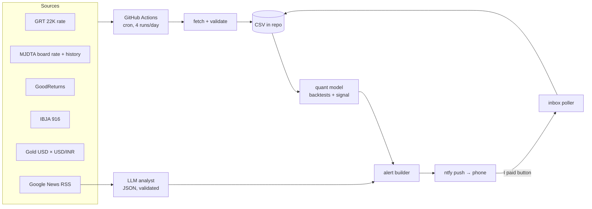

# Zari: gold pay-day agent

[](../../actions/workflows/ci.yml)

Zari is a small, fully automated agent that watches India's 22K gold rate every day. It tells you,
on your phone, when to pay a monthly gold purchase-plan instalment, and it logs what you bought.
It runs for **₹0/month**: GitHub Actions does the scheduling, ntfy delivers push notifications,
and free LLM tiers add context.

> In a jeweller's purchase plan, each monthly payment buys grams at that day's rate, and it must be
> paid within a window (1st–10th). So the question is: **which day in the window gives the most gold?**

<sub>Zari (ज़री) is the fine gold thread woven into Indian silks.</sub>

---

## What it does
- **Reads four live sources** every day: GRT Jewellers (the pay rate), the Madras Jewellers' Association board
  rate, GoodReturns and IBJA. It checks freshness and sanity, and flags any disagreement between sources.
  A failed source is reported in the alert, never silently skipped.
- **Pushes phone alerts:** ✅ PAY TODAY, escalating reminders before the deadline, a 🚨 LAST DAY alert,
  an alert when the rate is revised down, big-drop warnings, a weekly digest and a monthly recap.
- **Logs payments in two ways:** an **"I paid"** button on the notification, or a typed reply
  (`paid 10000 13340`, `undo`). The agent polls the reply channel and keeps running totals in grams.
- **Estimates tomorrow's rate** from the overnight move in international gold × USD/INR.
- **Adds an AI analyst** (GitHub Models, with Gemini as fallback). It reads ~18 fresh headlines plus an event
  calendar (Fed decisions, US jobs report) and returns **schema-validated JSON**. That output adds context
  only; the code computes every number. Each call is logged and scored against what gold actually did.

## Architecture


## Findings: research before features
I tested the "smart timing" idea on **12 years of daily rates (2015–2026, ~3,700 days)** before building
alerts around it. Each strategy was tuned on 2015–2022 and judged on **unseen 2023–2026 (46 months)**:

| Strategy | Saving vs paying on the 1st |
|---|---|
| Monte-Carlo optimal stopping (bootstrapped returns + AR(1), Longstaff–Schwartz) | −0.05% |
| Wait if tomorrow's estimate is lower (overnight signal) | −0.11% |
| Same, only when the 60-day trend is down | −0.01% |
| Wait for the first dip | −0.02% |
| Always pay on a fixed weekday | −0.10% … −0.58% |
| *Perfect hindsight (the ceiling)* | *+0.93%* |

The **overnight signal is genuinely predictive**: its 8 AM estimate gets the next rate's direction right
**87%** of the time, catches **97%** of moves larger than 1%, and halves the error of "no change"
(0.26% vs 0.52%). But in a rising market, knowing one day ahead doesn't produce a better pay day.

**Conclusion:** the agent recommends paying early in the window and uses the signal for heads-up alerts
only. Every waiting strategy tested cost money on unseen data, so the simple rule won on evidence.

## Tech
Python 3.11 · pandas / numpy · requests · GitHub Actions (cron, concurrency control, commits data back)
· ntfy (push + action buttons) · GitHub Models / Gemini (free tiers) · pytest (26 tests, offline fixtures)

## Run it
```bash
pip install -e ".[dev]"
python -m pytest                                   # 26 tests, no network
python -m zari fetch --dry-run                     # today's rate from all four sources
python -m zari backfill                            # build rate history (2015 to now) into data/
python -m zari backtest                            # optimal-stopping backtest
python -m zari signaltest                          # how predictive is gold × USD/INR?
python -m zari research                            # compare all timing strategies
python -m zari run --slot morning --dry-run --date 2026-12-01   # preview an alert
```

**Deploy your own copy:** copy `deploy/daily.yml` and `deploy/inbox.yml` into `.github/workflows/` of a
**private** repo. Then add the secrets `NTFY_ALERT_TOPIC` and `NTFY_REPLY_TOPIC` (long random topic names),
and optionally `GEMINI_API_KEY`. Subscribe to the alert topic in the ntfy app. Settings live in `config.yaml`.

## Project layout
```
src/zari/
  sources/      grt, mjdta (live + history), goodreturns, ibja: one parser per site
  fetch.py      run every source, validate freshness/sanity, choose the pay rate
  store.py      CSV storage, daily close, payments
  backfill.py   resumable, paginated history download
  analysis.py   model fit, simulation, optimal-stopping decision, backtest
  market.py     gold × USD/INR (Yahoo chart API) and next-rate estimate
  signal.py     signal accuracy and signal-rule backtests
  research.py   strategy variants, train/test split
  news.py, ai.py    headlines, event calendar, LLM analyst (validated JSON, logged, scored)
  notify.py, inbox.py, run.py, state.py    alerts, phone replies, scheduled slots, dedup state
tests/          parsers on trimmed page excerpts, logic, alerts
deploy/         the GitHub Actions schedules used in my private deployment
```

## Notes
- This is a personal timing tool, not investment advice. Gold is close to random day to day, and
  Zari never promises a "lowest" day.
- Rates come from public pages, fetched politely (pauses between requests). The test fixtures are
  small excerpts of those pages, kept only to test the parsers. No rate history is published here.
